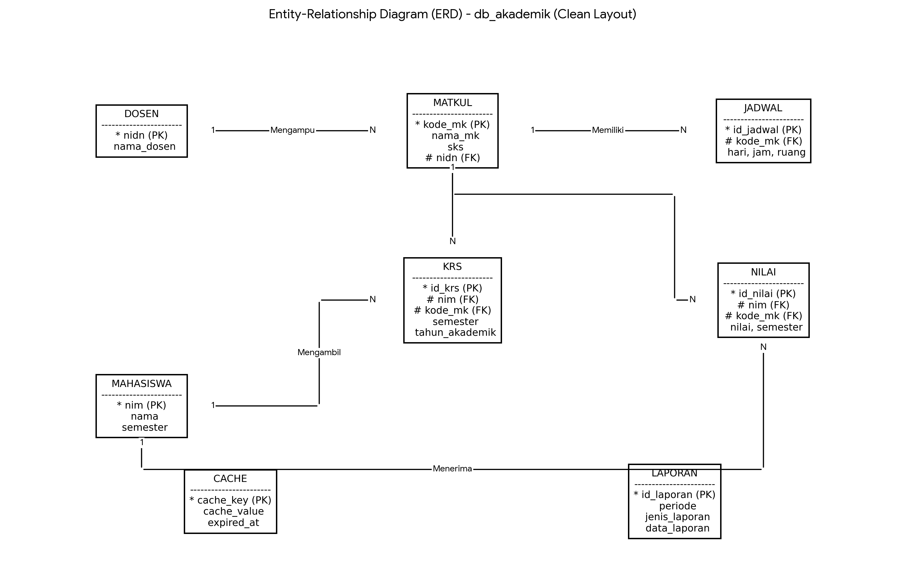

# 🎓 Sistem Informasi Akademik (`db_akademik`)

Laporan Evaluasi Mandiri dan Perancangan Basis Data Terstruktur untuk **Sistem Informasi Akademik (`db_akademik`)** dengan penambahan **Modul Manajemen Absensi Perkuliahan**.

---

## 📌 Latar Belakang & Perluasan Proses Bisnis

Sistem Informasi Akademik versi awal berfokus pada pendaftaran Kartu Rencana Studi (KRS) dan rekapitulasi nilai akhir. Namun, sistem menghadapi tantangan operasional dalam memantau keaktifan dan tingkat kehadiran mahasiswa per sesi perkuliahan mingguan.

Sebagai solusi, dilakukan penambahan proses bisnis berupa **Modul Manajemen Absensi Perkuliahan** (`absensi`). Modul ini mencatat rekapitulasi kehadiran mahasiswa pada setiap pertemuan yang terikat langsung dengan jadwal perkuliahan (`jadwal`) dan registrasi mata kuliah (`krs`) untuk penentuan syarat kelayakan Ujian Akhir Semester (UAS).

---

## 📐 Pemodelan Konseptual (Conceptual Model)

### Entity-Relationship Diagram (ERD)



### Identifikasi Entitas & Atribut Utama

| Entitas | Primary Key / Foreign Key | Atribut Lainnya |
| :--- | :--- | :--- |
| **`mahasiswa`** | `nim` (PK) | `nama`, `semester` |
| **`dosen`** | `nidn` (PK) | `nama_dosen` |
| **`matkul`** | `kode_mk` (PK), `nidn` (FK) | `nama_mk`, `sks` |
| **`jadwal`** | `id_jadwal` (PK), `kode_mk` (FK) | `hari`, `jam`, `ruang` |
| **`krs`** | `id_krs` (PK), `nim` (FK), `kode_mk` (FK) | `semester`, `tahun_akademik` |
| **`absensi`** *(Perluasan)* | `id_absensi` (PK), `id_krs` (FK), `id_jadwal` (FK) | `tgl_pertemuan`, `pertemuan_ke`, `status_hadir` |
| **`nilai`** | `id_nilai` (PK), `nim` (FK), `kode_mk` (FK) | `nilai`, `semester` |
| **`laporan`** | `id_laporan` (PK) | `periode`, `jenis_laporan`, `data_laporan` |
| **`cache`** | `cache_key` (PK) | `cache_value`, `expired_at` |

---

## 🔄 Normalisasi (Logical Modeling)

Perancangan basis data dilakukan melalui tahapan normalisasi hingga **3NF (Third Normal Form)**:

1. **UNF (Unnormalized Form):** Menampung seluruh data mentah rekam akademik dalam satu bentuk tunggal dengan *repeating groups*.
2. **1NF (First Normal Form):** Mengeliminasi *repeating group* sehingga seluruh atribut bernilai atomik (tunggal).
3. **2NF (Second Normal Form):** Memisahkan atribut berdasarkan *Functional Dependency* (`FD1` – `FD6`) untuk mengeliminasi ketergantungan parsial (*Partial Dependency*).
4. **3NF (Third Normal Form):** Memisahkan entitas `dosen` dari `matkul` (`nidn` $\rightarrow$ `nama_dosen`) untuk menghilangkan ketergantungan transitif (*Transitive Dependency*).

---

## 🛠️ Pemodelan Fisik (Physical Model & SQL)

### 1. Structure (DDL)

```sql
CREATE DATABASE IF NOT EXISTS `db_akademik` DEFAULT CHARACTER SET latin1 COLLATE latin1_swedish_ci;
USE `db_akademik`;

-- 1. Tabel Dosen
CREATE TABLE `dosen` (
  `nidn` INT(10) NOT NULL,
  `nama_dosen` VARCHAR(100) NOT NULL,
  PRIMARY KEY (`nidn`)
) ENGINE=InnoDB DEFAULT CHARSET=latin1;

-- 2. Tabel Mahasiswa
CREATE TABLE `mahasiswa` (
  `nim` VARCHAR(100) NOT NULL,
  `nama` VARCHAR(100) NOT NULL,
  `semester` INT(10) NOT NULL,
  PRIMARY KEY (`nim`),
  KEY `idx_nama_mahasiswa` (`nama`)
) ENGINE=InnoDB DEFAULT CHARSET=latin1;

-- 3. Tabel Matkul
CREATE TABLE `matkul` (
  `kode_mk` VARCHAR(100) NOT NULL,
  `nama_mk` VARCHAR(100) NOT NULL,
  `sks` INT(10) NOT NULL,
  `nidn` INT(10) DEFAULT NULL,
  PRIMARY KEY (`kode_mk`),
  KEY `nidn` (`nidn`),
  KEY `idx_nama_matkul` (`nama_mk`),
  CONSTRAINT `matkul_ibfk_dosen` FOREIGN KEY (`nidn`) REFERENCES `dosen` (`nidn`) ON DELETE SET NULL ON UPDATE CASCADE
) ENGINE=InnoDB DEFAULT CHARSET=latin1;

-- 4. Tabel Jadwal
CREATE TABLE `jadwal` (
  `id_jadwal` VARCHAR(100) NOT NULL,
  `kode_mk` VARCHAR(100) DEFAULT NULL,
  `hari` VARCHAR(100) NOT NULL,
  `jam` VARCHAR(100) NOT NULL,
  `ruang` VARCHAR(100) NOT NULL,
  PRIMARY KEY (`id_jadwal`),
  KEY `kode_mk` (`kode_mk`),
  CONSTRAINT `jadwal_ibfk_matkul` FOREIGN KEY (`kode_mk`) REFERENCES `matkul` (`kode_mk`) ON DELETE CASCADE ON UPDATE CASCADE
) ENGINE=InnoDB DEFAULT CHARSET=latin1;

-- 5. Tabel KRS
CREATE TABLE `krs` (
  `id_krs` VARCHAR(20) NOT NULL,
  `nim` VARCHAR(20) NOT NULL,
  `kode_mk` VARCHAR(20) NOT NULL,
  `semester` VARCHAR(20) NOT NULL,
  `tahun_akademik` VARCHAR(20) NOT NULL,
  PRIMARY KEY (`id_krs`),
  KEY `nim` (`nim`),
  KEY `kode_mk` (`kode_mk`),
  CONSTRAINT `krs_ibfk_1` FOREIGN KEY (`nim`) REFERENCES `mahasiswa` (`nim`) ON DELETE CASCADE ON UPDATE CASCADE,
  CONSTRAINT `krs_ibfk_2` FOREIGN KEY (`kode_mk`) REFERENCES `matkul` (`kode_mk`) ON DELETE CASCADE ON UPDATE CASCADE
) ENGINE=InnoDB DEFAULT CHARSET=latin1;

-- 6. Tabel Absensi (Perluasan Proses Bisnis)
CREATE TABLE `absensi` (
  `id_absensi` VARCHAR(20) NOT NULL,
  `id_krs` VARCHAR(20) NOT NULL,
  `id_jadwal` VARCHAR(100) NOT NULL,
  `tgl_pertemuan` DATE NOT NULL,
  `pertemuan_ke` INT(2) NOT NULL,
  `status_hadir` ENUM('Hadir', 'Izin', 'Sakit', 'Alpha') NOT NULL DEFAULT 'Hadir',
  PRIMARY KEY (`id_absensi`),
  KEY `id_krs` (`id_krs`),
  KEY `id_jadwal` (`id_jadwal`),
  CONSTRAINT `absensi_ibfk_1` FOREIGN KEY (`id_krs`) REFERENCES `krs` (`id_krs`) ON DELETE CASCADE ON UPDATE CASCADE,
  CONSTRAINT `absensi_ibfk_2` FOREIGN KEY (`id_jadwal`) REFERENCES `jadwal` (`id_jadwal`) ON DELETE CASCADE ON UPDATE CASCADE
) ENGINE=InnoDB DEFAULT CHARSET=latin1;

-- 7. Tabel Nilai
CREATE TABLE `nilai` (
  `id_nilai` VARCHAR(100) NOT NULL,
  `nim` VARCHAR(100) NOT NULL,
  `kode_mk` VARCHAR(100) NOT NULL,
  `nilai` VARCHAR(5) NOT NULL,
  `semester` VARCHAR(20) NOT NULL,
  PRIMARY KEY (`id_nilai`),
  KEY `nim` (`nim`),
  KEY `kode_mk` (`kode_mk`),
  CONSTRAINT `nilai_ibfk_1` FOREIGN KEY (`nim`) REFERENCES `mahasiswa` (`nim`) ON DELETE CASCADE ON UPDATE CASCADE,
  CONSTRAINT `nilai_ibfk_2` FOREIGN KEY (`kode_mk`) REFERENCES `matkul` (`kode_mk`) ON DELETE CASCADE ON UPDATE CASCADE
) ENGINE=InnoDB DEFAULT CHARSET=latin1;

-- 8. Tabel Laporan
CREATE TABLE `laporan` (
  `id_laporan` VARCHAR(20) NOT NULL,
  `periode` VARCHAR(50) NOT NULL,
  `jenis_laporan` VARCHAR(50) NOT NULL,
  `data_laporan` TEXT NOT NULL,
  PRIMARY KEY (`id_laporan`)
) ENGINE=InnoDB DEFAULT CHARSET=latin1;

-- 9. Tabel Cache
CREATE TABLE `cache` (
  `cache_key` VARCHAR(50) NOT NULL,
  `cache_value` TEXT NOT NULL,
  `expired_at` DATETIME NOT NULL,
  PRIMARY KEY (`cache_key`)
) ENGINE=InnoDB DEFAULT CHARSET=latin1;
```

---

### 2. Seeding Dummy Data (DML)

```sql
-- Insert Data Dosen
INSERT INTO `dosen` (`nidn`, `nama_dosen`) VALUES
(101201, 'Dr. Ahmad Fauzi, M.Kom.'),
(101202, 'Siti Aminah, M.T.'),
(101203, 'Dr. Budi Santoso, M.Sc.');

-- Insert Data Mahasiswa
INSERT INTO `mahasiswa` (`nim`, `nama`, `semester`) VALUES
('264311043', 'Glendy Devanno Ardiansyah Putra', 3),
('264311056', 'Restu Prayuga', 3),
('264311034', 'Alexsandria Cahaya Adzani', 3);

-- Insert Data Matkul
INSERT INTO `matkul` (`kode_mk`, `nama_mk`, `sks`, `nidn`) VALUES
('IF101', 'Pemrograman Berorientasi Objek', 4, 101201),
('IF102', 'Basis Data Terstruktur', 3, 101202),
('IF103', 'Struktur Data dan Algoritma', 3, 101203);

-- Insert Data Jadwal
INSERT INTO `jadwal` (`id_jadwal`, `kode_mk`, `hari`, `jam`, `ruang`) VALUES
('JD01', 'IF101', 'Senin', '08:00 - 10:30', 'Lab Komputer 1'),
('JD02', 'IF102', 'Rabu', '10:30 - 13:00', 'Ruang Teori 3.2'),
('JD03', 'IF103', 'Jumat', '13:30 - 16:00', 'Lab Komputer 2');

-- Insert Data KRS
INSERT INTO `krs` (`id_krs`, `nim`, `kode_mk`, `semester`, `tahun_akademik`) VALUES
('KRS01', '264311043', 'IF101', 'Ganjil', '2026/2027'),
('KRS02', '264311043', 'IF102', 'Ganjil', '2026/2027'),
('KRS03', '264311056', 'IF102', 'Ganjil', '2026/2027'),
('KRS04', '264311034', 'IF103', 'Ganjil', '2026/2027');

-- Insert Data Absensi
INSERT INTO `absensi` (`id_absensi`, `id_krs`, `id_jadwal`, `tgl_pertemuan`, `pertemuan_ke`, `status_hadir`) VALUES
('ABS01', 'KRS01', 'JD01', '2026-09-07', 1, 'Hadir'),
('ABS02', 'KRS01', 'JD01', '2026-09-14', 2, 'Hadir'),
('ABS03', 'KRS02', 'JD02', '2026-09-09', 1, 'Hadir'),
('ABS04', 'KRS02', 'JD02', '2026-09-16', 2, 'Izin'),
('ABS05', 'KRS03', 'JD02', '2026-09-09', 1, 'Hadir'),
('ABS06', 'KRS04', 'JD03', '2026-09-11', 1, 'Hadir');

-- Insert Data Nilai
INSERT INTO `nilai` (`id_nilai`, `nim`, `kode_mk`, `nilai`, `semester`) VALUES
('NIL01', '264311043', 'IF101', 'A', 'Ganjil'),
('NIL02', '264311043', 'IF102', 'AB', 'Ganjil'),
('NIL03', '264311056', 'IF102', 'B', 'Ganjil'),
('NIL04', '264311034', 'IF103', 'A', 'Ganjil');

-- Insert Data Laporan
INSERT INTO `laporan` (`id_laporan`, `periode`, `jenis_laporan`, `data_laporan`) VALUES
('LAP01', '2026/2027 Ganjil', 'Rekap Kehadiran dan Nilai', '{"total_mahasiswa": 3, "rata_kehadiran": "91.6%"}');

-- Insert Data Cache
INSERT INTO `cache` (`cache_key`, `cache_value`, `expired_at`) VALUES
('dashboard_stats', '{"active_users": 120, "active_classes": 15}', '2026-12-31 23:59:59');
```

---

## 🚀 Petunjuk Penggunaan

1. Buka DBMS pilihan Anda (misalnya **MySQLWorkbench**, **phpMyAdmin**, atau **DBeaver**).
2. Jalankan perintah pembuatan database dan struktur DDL.
3. Eksekusi script DML (`INSERT INTO`) untuk mengisi data awal.
4. Lakukan pengujian *query* relasi antar tabel (misalnya Join antara `mahasiswa`, `krs`, `jadwal`, dan `absensi`).
